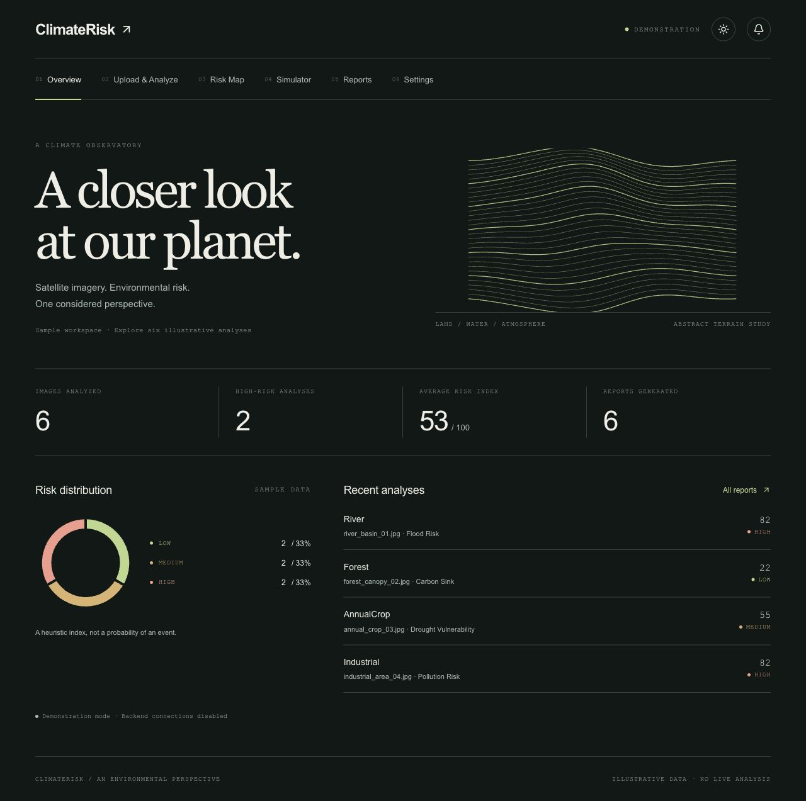
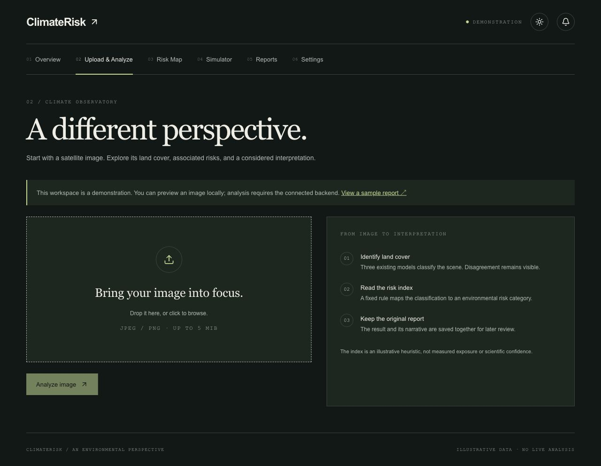
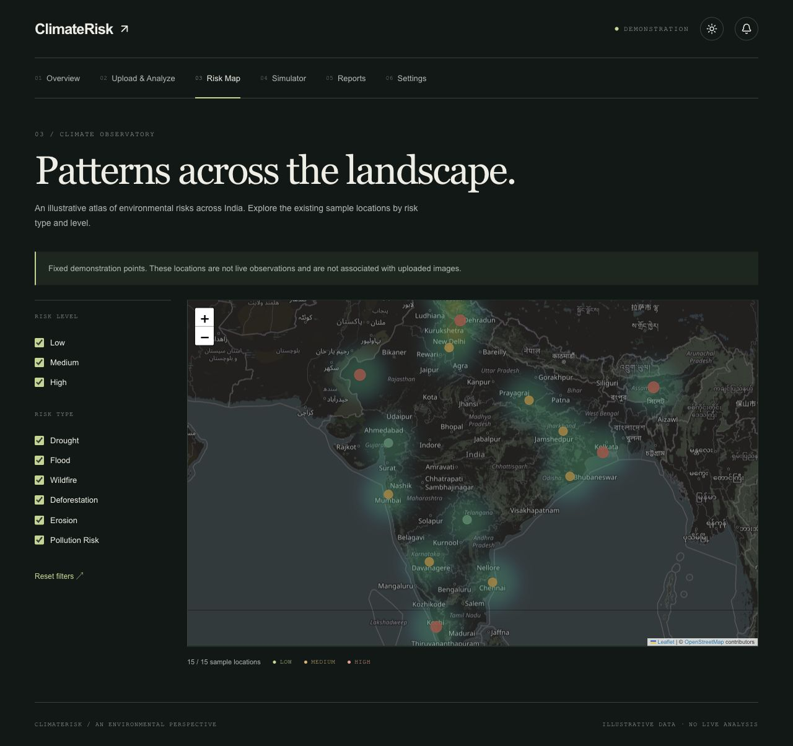
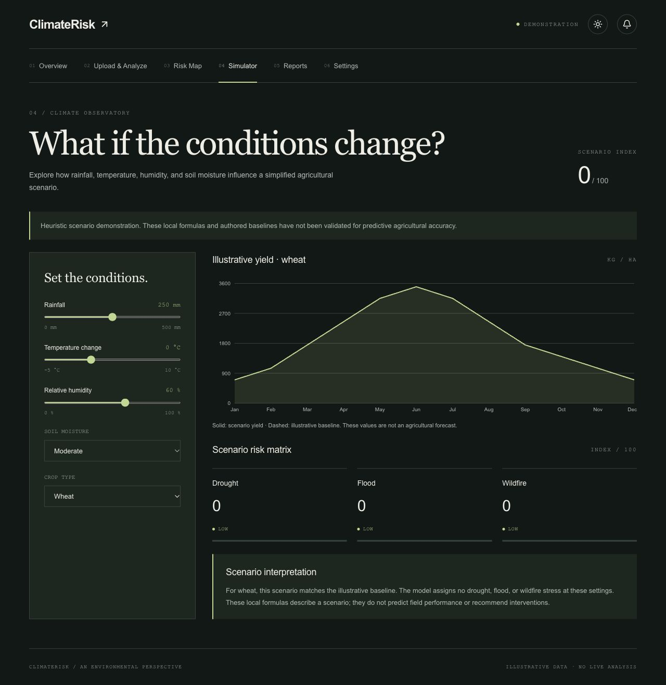
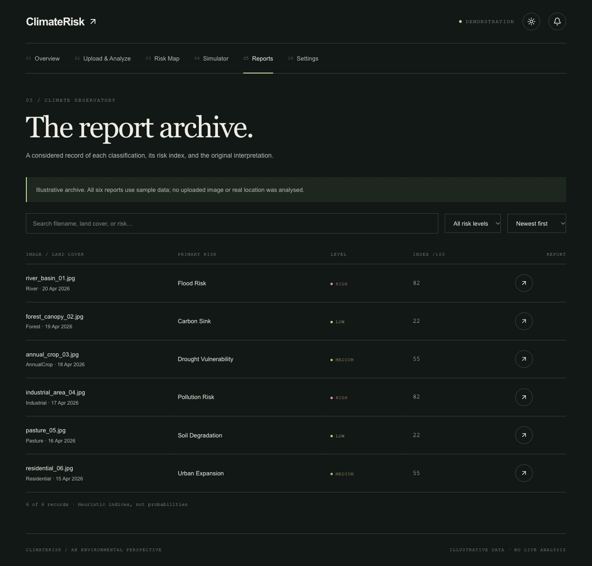
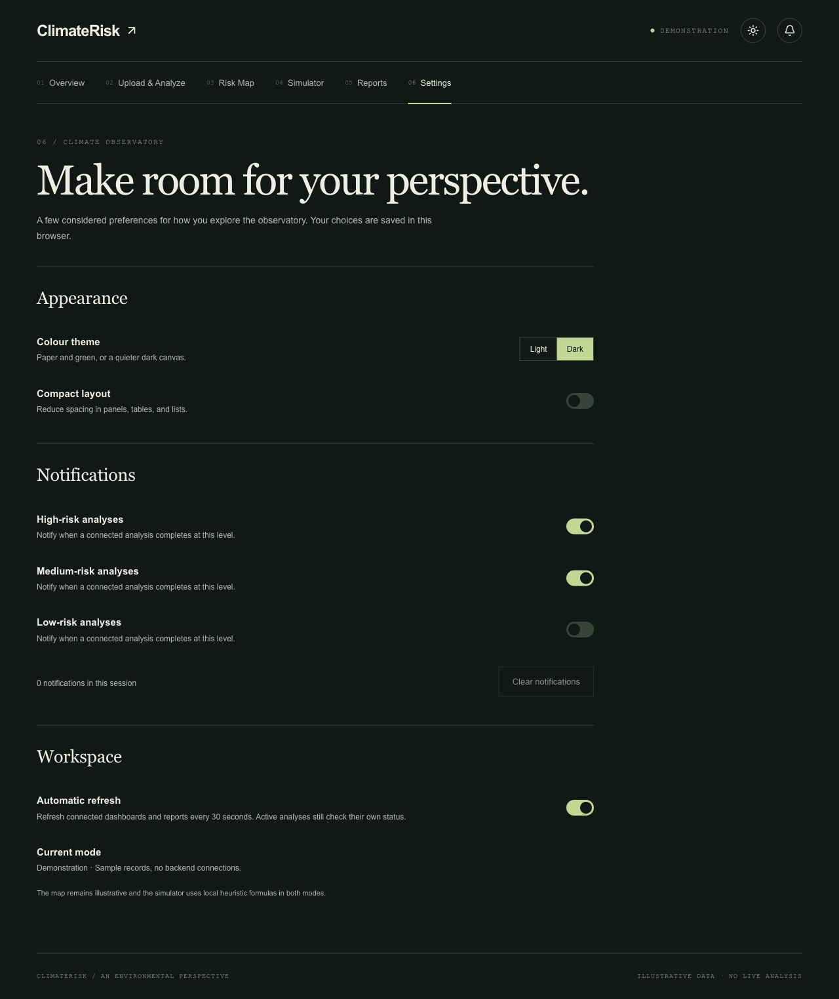
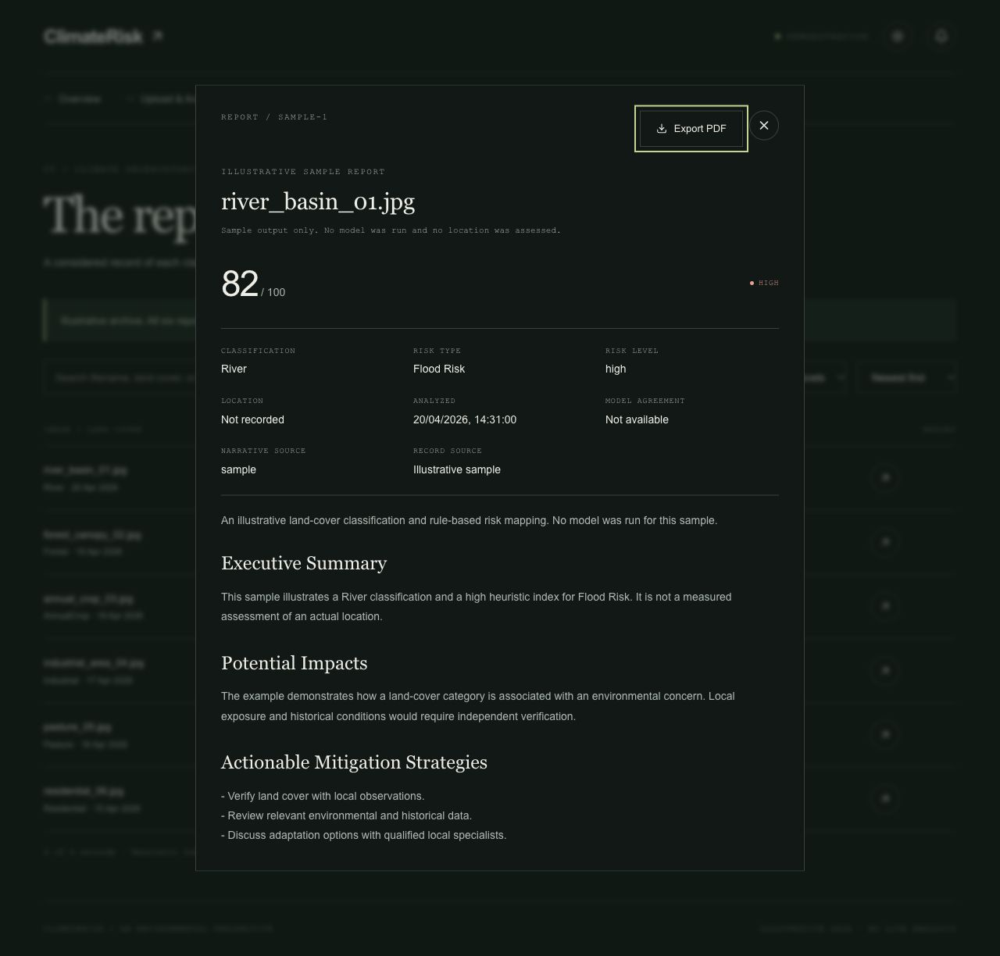
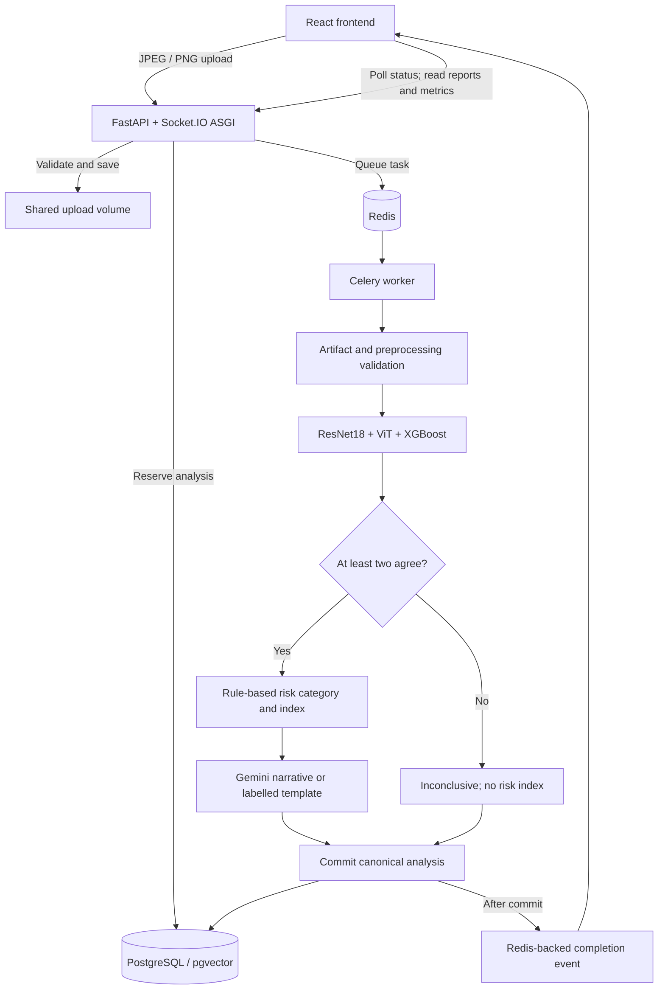

<div align="center">

# ClimateRisk Observatory

### A closer look at our planet.

Satellite imagery · Land-cover classification · Environmental risk interpretation

[](https://github.com/Archit-k20/Climate-Observatory/actions/workflows/checks.yml)


[The interface](#the-interface) · [Quick start](#quick-start) · [Full-stack setup](#full-stack-setup) · [How it works](#how-it-works) · [Model verification](docs/model-artifacts.md)



</div>

A college project revisited with a quieter visual language and more reliable workflows. ClimateRisk combines satellite land-cover classification, rule-based environmental risk indices, a scenario simulator, and an archive of saved analyses. This repository includes the **React frontend, Python backend, ML source and Git LFS model artifacts**, Docker configuration, migrations, and regression tests.

It continues [Archit-k20/Climate-Risk-System](https://github.com/Archit-k20/Climate-Risk-System), preserving the original source history and feature set while repairing misleading results, upload handling, and report persistence.

> **Before running inference:** this is an environmental-analysis demonstration, not a validated scientific forecasting system. The archived checkpoint binaries do not establish their training or preprocessing compatibility. Connected analysis stays unavailable until genuine training metadata has been recovered and verified. [Model setup and verification →](docs/model-artifacts.md) Demo mode works immediately without those artifacts.

## The interface

Warm paper and forest green in light mode; deep green and soft chart colours in dark mode. The sun/moon control in the header changes the theme from the home page or any screen, shares the saved preference in Settings, supports keyboard operation, and remains available on mobile.

**Every screenshot below is dark mode, captured from the running app with explicitly labelled sample data.** These are not screenshots of a successful real-model inference run.

| Screen | Existing workflow |
| --- | --- |
| **Overview** | Completed-analysis metrics, risk distribution, recent reports, and checked service status in connected mode. |
| **Upload & Analyze** | JPEG/PNG selection, uncropped preview, genuine processing states, model votes, risk index, and saved interpretation. Demo mode links to a sample report instead of analysing the selected image. |
| **Risk Map** | Illustrative locations, filters, markers, heatmap, legend, and visible attribution. |
| **Simulator** | Existing scenario controls, crop-yield chart, risk matrix, and heuristic scenario interpretation. |
| **Reports** | Search, risk filters, sorting, original report details, and PDF export. |
| **Settings** | Persistent theme, compact layout, automatic refresh, and notification preferences. |

<table>
  <tr>
    <td width="50%"><strong>Upload & Analyze</strong><br></td>
    <td width="50%"><strong>Risk Map</strong><br></td>
  </tr>
  <tr>
    <td width="50%"><strong>Simulator</strong><br></td>
    <td width="50%"><strong>Reports</strong><br></td>
  </tr>
  <tr>
    <td width="50%"><strong>Settings</strong><br></td>
    <td width="50%"><strong>Saved interpretation</strong><br></td>
  </tr>
</table>

## Choose a runtime mode

| | `demo` | `connected` |
| --- | --- | --- |
| Data | Six consistent, deterministic sample records | Records from your configured backend |
| API / Socket.IO | No connection attempts | REST, task polling, and completion events |
| Upload | Local preview only; existing sample report | Validated upload and queued analysis |
| Model artifacts | Not required | Verified binaries **and** training metadata |
| Empty / failed state | Explicit sample workspace | Remains empty or failed; never replaced by samples |
| Intended use | Explore the UI; frontend-only Vercel deployment | Local full-stack development and verification |

Both modes keep map locations illustrative and simulator formulas heuristic. Demo mode fetches map tiles from OpenStreetMap, so it is independent of the backend but not fully offline.

## Quick start

### Prerequisites

- **Node.js 24** and npm for the frontend.
- **Git**; **Git LFS** for the archived model binaries.
- **Docker Desktop** or Docker Engine with the Compose v2 plugin for the backend. Start Docker before running Compose.
- Internet access for packages, container images, and map tiles. The first backend build downloads the ML runtime and can take several minutes.

Docker supplies **Python 3.11** and pinned backend/ML dependencies; a host Python installation is not required. The default inference runtime uses the CPU.

### Start the frontend demo

```sh
# Skip large model downloads while exploring the interface.
GIT_LFS_SKIP_SMUDGE=1 git clone https://github.com/Archit-k20/Climate-Observatory.git
cd Climate-Observatory/frontend
npm ci
cp .env.example .env.local
npm run dev
```

Open **http://localhost:3000**. The example selects `VITE_APP_MODE=demo`. Use the theme control beside the notification bell to switch modes; the preference survives reloads.

## Full-stack setup

The steps below start the complete local application. Inference remains explicitly unavailable until model verification is satisfied; the API, database, archive, upload validation, and worker can still be exercised.

### 1. Start the backend services

From the repository root:

```sh
cp .env.example .env
docker compose up --build -d
docker compose ps -a
```

Compose starts PostgreSQL/pgvector and Redis, runs the additive Alembic migration, then starts the API and worker. The migration container should exit successfully; the other services remain running.

| Service | Local address | Purpose |
| --- | --- | --- |
| Frontend | `http://localhost:3000` | Vite; started separately |
| API | `http://localhost:8000` | FastAPI wrapped by Socket.IO ASGI |
| API docs | `http://localhost:8000/docs` | Interactive OpenAPI documentation |
| Health | `http://localhost:8000/api/v1/health` | API, database, Redis, and model readiness |
| PostgreSQL | `localhost:5433` | Database `climate_ai`; local user/password `climate_user` / `climate_pass` |
| Redis | `localhost:6379` | Celery queue and completion-event delivery |

Backend ports bind to loopback. These are local development credentials; the setup does not provision a public backend or authentication service.

```sh
curl http://localhost:8000/api/v1/health
docker compose logs --tail=100 api worker migrate
```

Before model verification, this is an expected response:

```json
{
  "status": "degraded",
  "services": {
    "api": "healthy",
    "database": "healthy",
    "redis": "healthy",
    "model": "unavailable"
  }
}
```

The stack is running, but inference is disabled. This is not a successful real-model smoke test.

### 2. Retrieve and verify the ML artifacts

Install [Git LFS](https://git-lfs.com/) if needed, then run from the repository root:

```sh
git lfs install --local
git lfs pull --include="ml/models/*"
git lfs fsck
```

The four active binaries total approximately **448 MiB**. Follow [docs/model-artifacts.md](docs/model-artifacts.md) to check their hashes, recover the original training configuration, and create `ml/models/manifest.json` **only after compatibility is established**. The verification manifest is intentionally ignored by Git.

Do not create a manifest just to turn the health check green. Genuine training metadata for these archived checkpoints has not yet been verified. Missing, corrupt, and incompatible models fail explicitly.

After installing verified artifacts and metadata:

```sh
docker compose restart api worker
curl http://localhost:8000/api/v1/health
```

### 3. Connect the frontend

Create or edit `frontend/.env.local`:

```dotenv
VITE_APP_MODE=connected
VITE_API_URL=http://localhost:8000/api/v1
VITE_SOCKET_URL=http://localhost:8000
```

In a second terminal:

```sh
cd frontend
npm ci
npm run dev
```

Open **http://localhost:3000**. The header should say **Connected workspace**. Restart Vite after changing `.env.local`; these settings are read at startup/build time.

### 4. Run through the workflow

1. Open **Upload & Analyze** and choose a valid JPEG or PNG, up to **5 MiB (5,242,880 bytes)**.
2. Click **Analyze image**. The backend validates the contents, saves the image, and reserves its analysis record.
3. The worker runs the validated ensemble. The UI polls task status; Socket.IO can also deliver completion updates.
4. A majority classification produces a saved risk category, fixed heuristic index, model votes, and original narrative. Completion is reported only after a database commit.
5. Open the entry in **Reports**. Its details and PDF use the saved content and provenance.

Unavailable models produce a recorded failure, not an invented score or completed report. Three-way disagreement is **inconclusive** and has no risk index. A frontend polling timeout offers another status check and does not claim the worker stopped. Clearing/replacing the image clears its visible result and prevents an earlier request from updating the new selection.

### 5. Stop and resume

```sh
# Stop services without deleting database, Redis, or upload volumes.
docker compose down

# Resume later; add --build after backend source/dependency changes.
docker compose up -d
```

Stop Vite with `Ctrl+C`. Use `docker compose down -v` only if you deliberately intend to delete local application data.

## How it works



### Classification and interpretation

- **ResNet18 and ViT:** shared 224 × 224 RGB transform with ImageNet normalization.
- **XGBoost:** seven original features at 64 × 64: mean red/green/blue, Canny edge density, and GLCM contrast/homogeneity/energy.
- **Ensemble:** two or three matching votes produce a classification. Three different votes remain inconclusive. All votes are retained.
- **Risk index:** original Low / Medium / High rules map to **22 / 55 / 82**, labelled **Heuristic risk index /100**. Agreement is a separate count out of three, never calibrated confidence.
- **Narrative:** optional Gemini generation or a structured template with an accurate fallback reason. The original text is stored rather than regenerated when a report opens.

The [ML guide](ml/README.md) distinguishes the active runtime from historical experiments. The map and simulator are demonstrations; neither is a live geographic feed or a validated agricultural forecast.

### Persistence and provenance

The additive `analyses` table stores the image association, task ID, lifecycle status, timestamps, classification, index, votes, model version, original narrative, narrative source, and failure reason. Repeated submissions for the **same uploaded image ID** and worker retries reuse its record; a separate upload gets its own image ID. Completion requires a successful database commit.

Lifecycle: `queued` → `running` → `completed`, `inconclusive`, or `failed`. Polling and socket events use the same persisted result. Socket disconnection does not prevent task completion or status polling.

Existing `images` and `risk_scores` rows are preserved. The archive displays the latest historical record per image without deleting older rows. Unknown historical locations, narratives, and provenance remain explicitly incomplete. Legacy records are excluded from new-analysis dashboard metrics.

### Main API routes

Paths are relative to `/api/v1`. See `/docs` for full schemas.

| Method | Path | Purpose |
| --- | --- | --- |
| `GET` | `/health` | Checked service readiness |
| `POST` | `/images/upload` | Validate multipart field `file` and save image |
| `POST` | `/images/{id}/analyze-async` | Queue/reuse analysis and return task ID |
| `GET` | `/images/{id}/analyze` | Existing synchronous analysis path |
| `GET` | `/images/tasks/{task_id}` | Persisted lifecycle state and result |
| `GET` | `/images/reports/full` | Reports; supports `skip` and `limit` |
| `GET` | `/images/stats/summary` | Completed-analysis metrics |
| `GET` | `/images/stats/distribution` | Stored risk-level counts |
| `GET` | `/images/{id}/file` | Original uploaded image |

## Configuration

| Setting | Location | Meaning |
| --- | --- | --- |
| `VITE_APP_MODE` | `frontend/.env.local` | `demo` (default) or `connected` |
| `VITE_API_URL` | `frontend/.env.local` | REST URL including `/api/v1` |
| `VITE_SOCKET_URL` | `frontend/.env.local` | Socket.IO origin, without `/api/v1` |
| `VITE_MAP_TILE_URL` / `VITE_MAP_ATTRIBUTION` | `frontend/.env.local` | Optional authorized map provider and attribution |
| `API_PORT` | Root `.env` or shell | Published API port; default `8000` |
| `CORS_ORIGINS` | Root `.env` | Comma-separated allowed frontend origins |
| `GEMINI_API_KEY` / `GEMINI_MODEL` | Root `.env` | Optional narrative credentials and available model ID |
| `DATABASE_URL` / `REDIS_URL` | Backend process environment | Compose supplies container-network URLs |
| `UPLOAD_DIR` / `MODEL_DIR` | Backend process environment | Shared upload storage and read-only models |
| `ANALYSIS_TIMEOUT_SECONDS` | Backend process environment | Default `600` seconds |

Compose's fixed database/Redis/storage values can be changed through a local `docker-compose.override.yml`; placing those keys only in root `.env` does not override literal Compose values. Keep database credentials consistent across PostgreSQL, API, migration, worker, and test services.

**Never put secrets in `VITE_` variables:** those values are exposed to the browser. Environment files, uploads, and the model verification manifest are ignored by Git.

Without both Gemini settings, or if generation fails, reports use a labelled template. The provider is optional and receives classification/risk context for narrative generation. Credentials belong only in the backend environment.

## Repository layout

```text
Climate-Observatory/
├── frontend/                 React, TypeScript, Vite, UI and tests
├── backend/
│   ├── app/                  API, services, models and schemas
│   ├── migrations/           Additive Alembic migrations
│   └── tests/                Workflow/persistence regression suite
├── ml/
│   ├── models/               Four active Git LFS artifacts
│   ├── ensemble/             Validation, loading and majority voting
│   ├── datasets/             Shared transforms
│   ├── features/             Original XGBoost feature extraction
│   ├── risk/                 Original land-cover/risk mapping
│   ├── explainability/       Experiment utilities
│   └── archive_demo/         Historical experiments
├── docs/                     Model verification and dark screenshots
├── .github/workflows/        Frontend and container checks
├── Dockerfile                Python 3.11 / CPU ML image
├── docker-compose.yml        API, worker, migration, database and Redis
└── vercel.json               Repository-root demo deployment config
```

**Frontend:** React 18, TypeScript, Vite 7, Tailwind 4, Leaflet, Recharts, Framer Motion, Zustand, TanStack Query, Socket.IO. **Backend:** FastAPI, SQLAlchemy, Alembic, PostgreSQL/pgvector, Redis, Celery. **ML:** PyTorch, Transformers, XGBoost, OpenCV, scikit-image. The preserved similarity endpoint is not populated with invented embeddings.

## Verification

### Frontend

```sh
cd frontend
npm ci
npm run lint
npm test
npm run build
```

### Backend integration

With Compose running, from the repository root:

```sh
docker compose exec -T postgres createdb -U climate_user climate_test
docker compose --profile test run --rm test
```

Skip `createdb` if `climate_test` already exists. Tests use this separate database and roll back transactions, not the application database `climate_ai`.

GitHub Actions runs frontend lint/tests/build and Docker-backed regression tests on pushes and pull requests. Coverage includes upload boundaries, stale requests, retries, database failures, saved narratives, historical preservation, deterministic voting, preprocessing, explicit model unavailability, and demo/connected separation. Successful workflow tests use a **stub predictor** and do not establish archived-checkpoint accuracy.

## Frontend deployment on Vercel

Vercel serves an explicitly labelled **demo**. This repository does not provision a hosted API, worker, database, or Redis service.

| Setting | Value |
| --- | --- |
| Root directory | `frontend` |
| Framework / Node | Vite / `24.x` |
| Install | `npm ci` |
| Build | `VITE_APP_MODE=demo npm run build` |
| Output | `dist` |

`frontend/vercel.json` rewrites `/upload`, `/risk-map`, `/simulator`, `/reports`, and `/settings` to the SPA entrypoint. API and asset paths remain outside that fallback. The root `vercel.json` also supports a Vercel project using the repository root instead of `frontend`.

Creating a new GitHub repository does **not** automatically reconnect an existing Vercel project. The original project/domain stays on its configured source until deliberately changed. Review a preview and verify all direct routes/reloads before production promotion. See [Vercel's Vite guidance](https://vercel.com/docs/frameworks/frontend/vite#using-vite-to-make-spas).

## Troubleshooting

| Symptom | Check |
| --- | --- |
| Cannot connect to Docker | Start Docker Desktop / the daemon, then retry Compose. |
| Port 8000 occupied | Use `API_PORT=18080 docker compose up --build -d`, change both frontend URLs to port 18080, and restart Vite. Persist it in root `.env` if desired. |
| Database / Redis port conflict | Change the host-side port in a local Compose override; internal addresses stay `postgres:5432` and `redis:6379`. |
| Frontend cannot reach API | Check health, both `VITE_` URLs, and `CORS_ORIGINS`. Use the documented `http://localhost:3000` frontend origin. |
| Mode change ignored | Restart Vite; rebuild deployed bundles. The mode is not read dynamically. |
| Model metadata missing | Retrieve binaries and follow the verification guide. Do not fabricate compatibility metadata. |
| Model file begins `version https://git-lfs.github.com/spec/v1` | It is a pointer. Install Git LFS and pull models. ZIP downloads may not contain real binaries. |
| Task remains queued | Inspect `docker compose logs --tail=100 worker redis`; API and worker must share database and Redis configuration. |
| UI is still waiting | Use the status-check action. The two-minute UI polling window does not cancel the task. |
| Migration fails on existing database | Inspect `docker compose logs migrate`; preserve/back up data and fix the migration cause instead of deleting volumes. |
| Map tiles missing | Check connectivity and provider policy. The map is illustrative, not a live climate feed. |
| Missing historical narrative/location | The original values were not stored; replacements are intentionally not invented. |

## Provenance and limits

- [Original college project](https://github.com/Archit-k20/Climate-Risk-System): source history and existing frontend/backend/ML workflows are preserved.
- Map data: [OpenStreetMap contributors](https://www.openstreetmap.org/copyright). Follow the [tile usage policy](https://operations.osmfoundation.org/policies/tiles/); no offline download or bulk prefetch is implemented.
- Existing datasets and experiment files retain their original provenance; inclusion does not imply new licensing rights or a new evaluation benchmark.
- No model retraining, new datasets, real-time geographic feeds, paid backend hosting, or scientific-calibration claims are part of this rework.
